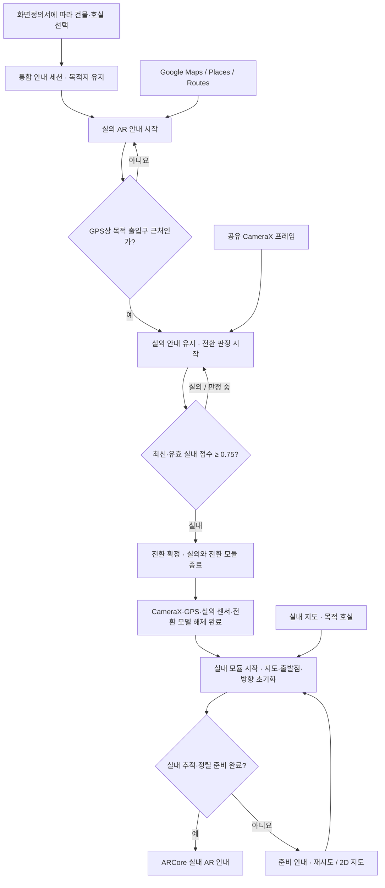
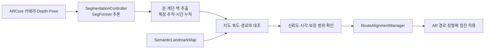

# 숭실대학교 캠퍼스 AR 내비게이션 아키텍처

수정일: 2026-11-19 · 기준: 현재 저장소 구현 및 전체 파이프라인 통합 설계

## 1. 전체 구조

목표는 **현재 위치에서 목적 건물까지 실외로 이동한 뒤, 건물 내부의 목적 호실까지 안내하는 것**입니다. 제품 요구사항은 [PRD](PRD.md)를 기준으로 합니다.

통합 목표 흐름은 **목적지 설정 → 실외 AR 안내 → GPS 근접 시 전환 판정 시작 → 실내 판정 시 실외·전환 종료 → 실내 안내 시작**입니다. [전체 파이프라인 요청](../mds/10.전체파이프라인.md)의 조건을 반영한 설계이며, 구체적인 단계는 7절에 정의합니다. 통합본은 현재 수동 출입구 지정·출발점 확인을 포함한 문화관 파일럿 흐름을 구현합니다.

현재는 실외 안내, 실내·외 판정, 실내 안내가 **각각 독립된 Android 앱**으로 구현되어 있습니다. 기존 앱들은 독립적으로 유지합니다. 새 [AR_Navigation_Final](../AR_Navigation_Final/)에는 실외 앱을 호스트로 전환 추론과 실내 라이브러리를 연결했습니다. 구체적인 사용 방법과 검증 범위는 [통합본 실행 가이드](통합본%20실행%20가이드.md)를 참고하세요.

| 프로젝트 | 역할 | 현재 상태 |
|---|---|---|
| [outdoor_navi](../outdoor_navi/) | 건물까지 실외 경로 탐색과 카메라 방향 안내 | 개별 앱 구현 |
| [Entrance_Transition](../Entrance_Transition/) | 문화관 실내·실외 판정 | 개별 앱 구현, 환경 텍스트와 마스크 표시 |
| [indoor_navi/src](../indoor_navi/src/) | 실내 경로 탐색, AR 경로선, 비전 기반 정렬 보정 | 개별 앱 구현, 현장 검증 필요 |
| [Model_Evaluation](../Model_Evaluation/) | 비전 모델 비교·평가 | 개발용 도구 |

아래 그림은 **통합 후 실행할 목표 흐름**입니다. 통합본은 이 순서로 모듈을 연결하며, 건물·호실 자동 식별과 실내 자동 절대 측위는 후속 범위입니다.



## 2. 실외 안내

실외 앱은 GPS 위치와 기기 방향으로 **다음 경유점이 어느 방향에 있는지** 계산합니다. Google Maps SDK는 지도를 표시하고, Places는 장소 검색, Routes는 보행 경로 생성을 담당합니다. CameraX 화면 위의 화살표는 앱이 직접 표시합니다.

```text
목적지 검색·선택
→ Google 보행 경로 요청
→ 경로를 경유점 목록으로 변환
→ GPS·방향 센서로 진행 상태 계산
→ 다음 경유점을 가리키는 화살표 표시
→ 경로 이탈 시 재탐색
→ GPS상 목적 출입구 근접 시 전환 판정 활성화
→ 실내 판정이 확정될 때까지 실외 안내 유지
```

| 구성 | 담당 코드 |
|---|---|
| 지도·검색·목적지 선택 | `ui/map/MapFragment`, `PlaceSearchController` |
| 상태 관리 | `navigation/NavigationViewModel`, `NavigationUiState` |
| Google 경로 요청·응답 변환 | `routing/GoogleRouteProvider`, `GoogleRouteMapper`, `WaypointBuilder` |
| 위치·방향 수집 | `location/`, `heading/` |
| 경유점 진행·이탈·도착 | `RouteProgressTracker`, `ArrivalDetector`, `DirectionCalculator` |
| 카메라·화살표 표시 | `camera/`, `ui/ar/ArNavigationFragment`, `ArUiRenderer` |

위 경로는 `outdoor_navi/app/src/main/java/com/example/arnavigation/` 아래입니다. `RouteProvider`, `LocationProvider`, `HeadingProvider` 인터페이스로 외부 입력과 안내 로직을 분리합니다.

GPS·방향 신뢰도가 낮으면 화살표를 숨기고 지도나 보정 안내를 제공합니다. Google API 오류는 경로 오류 상태로 처리합니다. 현재 실외 안내는 카메라 위 방향 오버레이이며, 실내 앱처럼 ARCore 월드 좌표에 경로선을 고정하는 방식은 아닙니다.

## 3. 실내·외 전환 판정

전환 앱은 SegFormer-B0로 화면을 벽·바닥·천장·계단 등의 영역으로 나누고, 등록된 문화관 사진의 구조와 비교합니다.

```text
CameraX 프레임
→ SegFormer-B0 추론
→ 픽셀별 의미 영역 마스크
→ gate1~4와 구조 비교
→ 최고 유사도를 실내 점수로 선택
→ 실내 / 실외 / 판정 중 표시
```

| 조건 | 결과 |
|---|---|
| 유효한 실내 점수 ≥ 0.75 | 즉시 `실내` |
| 유효한 실내 점수 < 0.75 | 즉시 `실외` |
| 구조 부족·오류·오래된 결과 | `판정 중` |

실내 점수는 **4×4 영역 분포 유사도 60% + 영역 인접 관계 유사도 40%**로 계산합니다. gate1~4 중 가장 높은 값을 쓰며, 실외 점수 계산·연속 프레임 대기·진입 확인 버튼은 사용하지 않습니다. 픽셀 분류 확률 0.35 미만은 비교에서 제외하며, 이 값은 전환 기준 0.75와 별개입니다.

`MunhwaClassifier`가 모델과 점수 계산을, `EnvironmentTransitionController`가 상태 판정을 담당합니다. `TransitionCameraSession`은 프레임 수집과 추론 자원을 관리하고, `SegmentationOverlay`는 마스크를 카메라 좌표에 맞춰 표시합니다.

이 결과는 **문화관 실내 사진과 구조가 비슷하다는 판단**입니다. 건물 ID, 층, 현재 좌표나 실제 문 통과 여부를 알아낸 결과는 아닙니다. 상세 실행 방법과 영상 결과는 [문화관 전환 모듈](문화관%20전환%20모듈.md)에 있습니다.

## 4. 실내 안내

실내 앱은 실내 지도 그래프에서 경로를 찾고, ARCore의 상대 이동 추적을 이용해 바닥에 경로선을 표시합니다.

```text
지도·출발지·목적지 선택
→ 지도 JSON 검증 및 그래프 구성
→ A* 경로 탐색
→ 층별 경로 분리
→ 지도 좌표를 AR 좌표로 변환
→ 실제 출발점에서 바닥·방향 정렬
→ AR 경로선 표시와 이동 진행 처리
```

| 구성 | 담당 코드 |
|---|---|
| AR 세션·화면·안내 흐름 | `HelloArActivity` |
| 지도·출발지·목적지 선택 | `MapRouteActivity` |
| 지도 로딩·검증 | `map/IndoorMapRepository`, `IndoorMapValidator` |
| 경로 탐색·층별 분리 | `routing/AStarRouteEngine`, `FloorRoutePlanner` |
| 좌표 변환 | `coordinates/LocalMapCoordinateTransformer`, `RouteCoordinateAdapter` |
| AR 경로·진행 상태 | `ArRoutePlan`, `RouteLineGeometry`, `RouteProgress` |
| 계단·층 도착 추정 | `StairVisionDetector`, `StairDepthPath`, `StairFloorTracker` |
| AR 녹화·재생 | `ArDatasetController`, `ArRecordingStore` |

위 경로는 `indoor_navi/src/app/src/main/java/com/google/ar/core/examples/java/helloar/` 아래입니다.

**최초 출발 위치는 사용자가 지정합니다.** 문화관은 센서 자북 기준 반시계 85.5°를 기본 정렬값으로 사용하며 수동 방향 보정도 지원합니다. ARCore는 이 초기 정렬 이후의 상대 이동을 추적합니다.

층간 경로는 계단 등 전환 지점에서 나눠 안내합니다. 카메라 높이 변화로 다음 층 도착 가능성을 추정하지만, 실제 층은 사용자가 확인하고 다음 층 안내를 시작합니다. 현장 미검증 계단 연결과 도면 추정 거리를 실측 데이터로 취급하지 않습니다.

## 5. 실내 비전 기반 보정

실내 앱에도 SegFormer 추론과 보정 로직이 연결되어 있습니다. 전환 앱의 사진 유사도 판정과 목적이 다릅니다.

| 용도 | 비교 대상 | 출력 |
|---|---|---|
| 실내·외 판정 | 현재 장면 ↔ gate1~4의 구조 | 실내 점수와 환경 상태 |
| 실내 정렬 보정 | 관측한 문·계단·벽·복도 특징 ↔ 실내 지도 기준 | 경로의 수평 위치·방향 보정값 |



`localization/`의 특징 추적·지도 대조 결과를 융합하고, `MATCH_CONFIRMED` 상태의 최신 보정값만 적용합니다. 추적 상태가 정상이고 출발 앵커가 잡혀 있으며 보정 기능이 활성화되어 있어야 합니다. 갑작스러운 큰 위치·방향 변경은 제한하고, 허용한 보정도 서서히 적용합니다.

따라서 현재 비전 기능은 **안내 시작 후 위치·방향 정렬을 보정하는 기능**입니다. 처음부터 건물·호실·층을 자동 식별해 절대 위치를 초기화하는 기능까지 완료된 것은 아닙니다. 모델은 의미 영역을 출력하고, 지도와의 대응·위치 계산은 별도 코드가 수행합니다. 실기기 정확도는 현장 검증이 필요합니다.

## 6. 데이터·좌표·공통 코드

| 데이터 | 위치·역할 |
|---|---|
| 실외 경로 | Google 응답을 `OutdoorRoute`와 경유점으로 변환 |
| 원본 실내 그래프 | `map_node/graph.json` — 노드·간선·호실·근사 윤곽 |
| 실내 앱 지도 | `indoor_navi/src/app/src/main/assets/maps/` — 문화관 및 테스트 지도 |
| 전환 기준·모델 | `Entrance_Transition/app/src/main/assets/` — gate1~4 마스크와 ONNX |
| 실내 모델 | `indoor_navi/src/app/src/main/assets/segformer.onnx` 및 설정 파일 |
| 실험 영상·로그 | `assets/transition_results_075_gate1to4/` |

실외는 위도·경도, 실내 지도는 건물 로컬 미터 좌표, ARCore는 세션의 월드 좌표를 사용합니다. 세 좌표계를 그대로 섞을 수 없으며, 실내 안내에는 시작 위치·방향·바닥 기준의 변환이 필요합니다. 실내 층별 2D 지도는 실제 층고가 모두 확정된 3D 건축 모델이 아닙니다. `map_node`의 방 윤곽도 표시용 근사 도형입니다.

전환 앱에는 `com.example.arnavigation.entrance` 패키지의 마스크·구조 비교·추론 클래스 네 개가 모듈 내부에 포함되어 있어 단독 빌드할 수 있습니다. 같은 패키지 이름을 사용해도 두 앱이 실행 중 이벤트를 주고받는 연결은 아닙니다. 실내 앱의 세그먼테이션 구현은 별도 패키지입니다. 모델·전처리·프로필은 각 구현의 규격을 맞춰 사용해야 합니다.

`outdoor_navi`에 남은 `EntranceTransitionController`는 GPS·연속 관측을 사용한 이전 별도 판정기입니다. 현재 독립 전환 앱의 0.75 규칙과 구분하며, 실외 안내 화면의 실내 자동 전환이 이미 구현됐다고 해석하지 않습니다.

## 7. 통합 안내 파이프라인 — 목표 설계와 통합본

통합 안내 세션 제어기 하나가 목적지와 현재 단계를 유지하고 세 모듈의 시작·종료를 조정합니다. 사용자에게 앱 세 개를 차례로 직접 실행하게 하는 방식이 아니라, 통합 앱 내부에서 화면과 자원을 인계하는 구조를 목표로 합니다. 통합본은 실내 앱을 `indoor` 라이브러리로 포함하고 전환 분류기를 호스트 앱의 공유 CameraX 분석기로 연결했습니다. 아래 설계 중 자동 출입구 선정·절대 측위는 아직 구현되지 않았습니다.

### 7.1 목적지 설정과 실외 안내 시작

[화면정의서](화면정의서.md)의 화면 흐름을 따릅니다.

```text
SCR-001 홈 → SCR-002 건물 검색
  ├─ 건물 목적지 → 경로 생성·미리보기 → SCR-004 실외 AR 안내
  └─ 실내 지원 건물 → SCR-003 호실 선택
      → 건물·호실·권장 출입구 검증 → 경로 생성·미리보기 → SCR-004 실외 AR 안내
```

유효한 목적지로 경로 준비와 안내 시작이 완료되면 **실외 AR 내비게이션을 먼저 실행**합니다. 실내 호실을 선택했더라도 실외 경로의 도착점은 그 호실과 연결되는 권장 출입구이며, 최종 목적 호실은 세션에 계속 보관합니다. 화면정의서의 안내 시작 동작은 유지하고, 실내 전환을 위한 추가 확인 버튼은 두지 않습니다.

통합 파일럿은 현재 전환 기준이 준비된 **문화관**을 대상으로 합니다. 건물만 선택한 P0 목적지는 건물 도착으로 완료하고, 실내 호실·연결 데이터가 있는 목적지에 실내 전환을 적용합니다. 미지원 건물이나 출입구·호실 연결이 없는 목적지에는 자동 실내 전환을 제공하지 않습니다.

### 7.2 GPS 근접 시 전환 모듈 시작

실외 안내 중 최신 GPS 위치와 **선택한 출입구 좌표** 사이의 거리를 검사합니다. 건물 중심이나 실내 호실 좌표를 거리 기준으로 사용하지 않습니다.

```text
실내 연결이 가능한 목적지
AND GPS 위치가 최신이고 수평 정확도가 허용 범위 안임
AND 현재 위치와 선택 출입구의 거리 ≤ 근접 반경 R_near
→ 전환 판정을 한 번 시작
```

목표는 `R_near`, GPS 최대 허용 나이, 수평 정확도 상한을 출입구 설정값으로 관리하는 것입니다. 통합본의 초기값은 `JourneyGate`에 30m·5초·20m로 정의했으며, 출입구별 조정과 현장 검증은 남아 있습니다. 요청의 “거의 도달”을 거리 조건으로 정의한 것이며, 초기 설정값을 검증된 현장 기준으로 취급하지 않습니다. GPS 신뢰도가 낮으면 전환 판정의 신규 시작을 보류하고 기존 저신뢰 안내를 표시합니다. GPS 근접은 **모델 실행을 시작하는 조건**이며 실내 판정 기준에 점수로 합산하지 않습니다.

근접 조건을 충족하면 **실외 안내를 유지하면서 전환 모듈을 활성화**합니다. 전환 판정 중에는 CameraX 카메라 하나의 프레임을 실외 프리뷰와 전환 추론이 공유하도록 연결합니다. 기존 독립 앱의 `TransitionCameraSession`을 별도 카메라 소유자로 동시에 실행하지 않습니다. 실외·판정 중 결과만으로 실외 안내를 종료하지 않습니다.

### 7.3 실내 판정과 자원 인계

전환 모듈은 기존 규칙을 유지합니다. 최신·유효 관측에서 gate1~4 중 최고 구조 유사도가 **0.75 이상이면 즉시 실내**로 판정합니다. 실외 점수, 연속 관측 대기, 전환 확인 버튼은 추가하지 않습니다. 무효·만료 결과는 `판정 중`이며 인계를 시작하지 않습니다.

통합 세션이 `실내`를 처음 수신하면 다음 순서로 인계합니다.

1. 상태를 `HANDOFF`로 바꾸고 추가 전환 요청을 막습니다. 현재 세션 ID와 판정 시각이 맞는 이벤트만 수용합니다.
2. 전환 프레임 분석을 해제하고 진행 중 추론의 종료·모델 해제를 기다립니다. 이후 도착하는 이전 콜백은 버립니다.
3. 실외 AR 화살표·경로 갱신을 중지하고 실외 GPS 구독·방향 센서 구독·CameraX 프리뷰를 해제합니다. 늦게 도착하는 경로·위치 응답도 무시합니다.
4. **실외 모듈과 전환 모듈의 카메라 해제가 완료된 뒤 실내 모듈을 시작**합니다. 메모리에 유지한 목적지·지도·출입구 정보를 전달합니다.
5. 실내 모듈이 ARCore를 시작하고 실내 지도·출발점·방향·바닥 기준을 준비합니다. 추적과 정렬이 유효할 때 목적 호실까지 AR 경로를 표시합니다.

여기서 모듈 종료는 프로세스를 강제 종료하는 것이 아니라 **안내 작업·카메라·추론·센서 자원의 중지와 해제**를 뜻합니다. CameraX와 ARCore가 카메라를 동시에 점유하지 않도록 해제 완료를 인계 조건으로 사용합니다.

전환이 확정되면 전환 모델은 종료되므로 점수가 다시 내려갔다는 이유로 실외 모듈을 자동 재실행하지 않습니다. 통합 역방향 복귀는 별도 정책입니다. 독립 전환 앱에서 실내·외 표시가 반복될 수 있는 것과 통합 세션의 한 번만 수행하는 인계를 구분합니다.

### 7.4 실내 초기화에 전달할 데이터

| 값 | 공급 주체·역할 |
|---|---|
| 세션 ID·목적지 버전 | 통합 세션 — 중복·이전 이벤트 차단 |
| 건물 ID·출입구 ID·실외 도착 좌표 | 목적지·출입구 데이터 — GPS 근접 기준 |
| 실내 지도 ID·지도 버전 | 목적지 데이터 — 정확한 실내 그래프 선택 |
| 시작 층·출입구 시작 노드 | 출입구와 지도 사이 연결 데이터 — 출발점 후보 |
| 목적 호실·목적 층·목적 노드 | SCR-003 선택 결과 — 최종 목적지 유지 |
| 실내 판정·점수·관측 시각 | 전환 모듈 — 인계 시작 근거 |
| 위치·방향·바닥 정렬 및 추적 준비 상태 | 실내 모듈 — AR 경로 표시 가능 여부 |

전환 모델은 **환경 상태만 판정**하며 실제 위치·층·방향을 측정해 제공하지 않습니다. `matchedGate`도 사진 식별자이므로 출입구 ID나 실내 시작 노드로 직접 변환하지 않습니다. 시작점 후보는 선택한 출입구의 등록 연결 데이터에서 가져오고, 실제 출발 위치와 맞는지 확인해야 합니다.

현재 실내 모듈은 최초 출발점을 사용자가 지정합니다. 초기 통합에서도 이 확인·정렬 절차를 유지하고 목적 호실 선택은 이어받습니다. PRD의 Natural Landmark 기반 자동 절대 위치 초기화가 준비되면 해당 단계를 대체합니다. 실내 모듈 실행과 유효한 AR 경로 표시 시작은 별도 단계입니다.

### 7.5 세션 상태와 예외

| 상태 | 실행하는 기능 | 다음 조건 |
|---|---|---|
| `DESTINATION_SETUP` | 화면정의서의 목적지·경로 준비 | 목적지 검증·안내 시작 → `OUTDOOR_GUIDING` |
| `OUTDOOR_GUIDING` | 실외 GPS·방향·CameraX AR 안내 | 신뢰 가능한 GPS 근접 → `ENTRY_CHECKING` |
| `ENTRY_CHECKING` | 실외 안내 + 공유 프레임 전환 추론 | 최신·유효 실내 점수 ≥ 0.75 → `HANDOFF` |
| `HANDOFF` | 중복 인계 차단, 실외·전환 자원 정리 | 해제 완료 → `INDOOR_INITIALIZING` |
| `INDOOR_INITIALIZING` | 실내 지도·ARCore·출발점·정렬 준비 | 추적·정렬 유효 → `INDOOR_GUIDING` |
| `INDOOR_GUIDING` | 실내 AR 경로·진행·보정 | 목적 호실 도착 → 완료 |

- 전환 결과가 실외·판정 중이면 `ENTRY_CHECKING`을 유지합니다. 근접 경계의 GPS 흔들림으로 모델을 반복 시작하지 않습니다. 목적지 변경·취소 시에는 종료합니다.
- 전환 모델 오류는 실외 안내를 유지하면서 재시도를 제공합니다. 실내 판정을 임의로 만들어 인계하지 않습니다.
- 인계 자원 해제에 실패하면 실내 카메라를 열지 않고 복구 안내를 표시합니다. 실내 지도 로딩·ARCore·추적 준비 실패는 실내 준비 단계에서 재시도 또는 2D 제한 모드로 처리합니다.
- SCR-005에서 새 목적지가 확정되면 세션 버전을 갱신하고 기존 전환 관측을 폐기합니다. 변경을 취소하면 기존 목적지와 진행 상태를 유지합니다.
- 경로 취소 시 실행 중인 모든 모듈을 정리하고 SCR-001로 돌아갑니다. 화면 수명주기상 중지·복귀 시 이전 카메라·추론 결과를 재사용하지 않습니다.

이 요청은 PRD FR-105의 “전환 제안”을 **실내 판정에 따른 자동 인계**로 구체화합니다. 문서의 최신 요청을 반영한 통합 동작이며, PRD와 화면정의서의 상세 전환 정책을 맞추는 후속 작업이 필요합니다.

## 8. 실행·검증과 남은 작업

공통 환경은 Android, Java, Android Studio, 프로젝트별 Gradle Wrapper이며 Min SDK 24·Target SDK 36입니다. 실내 AR 안내는 ARCore 지원 기기가 필요합니다. 실외 Google 검색·경로에는 API 설정과 네트워크가 필요하고, 번들 모델의 추론과 로컬 지도 경로 계산은 기기 안에서 수행합니다.

Android Studio에서 실행할 폴더는 각각 `outdoor_navi`, `Entrance_Transition`, `indoor_navi/src`입니다. 각 폴더에서 빌드·단위 테스트·정적 검사를 수행합니다.

```bash
./gradlew :app:assembleDebug :app:testDebugUnitTest :app:lintDebug
```

카메라·AR·센서 자원은 화면 수명주기에 맞춰 중지·해제합니다. 추론은 별도 작업 스레드에서 처리하고 이전 세션의 결과는 버립니다. 실내 추적이 유효하지 않으면 정상 AR 경로 표시를 중단합니다. 카메라 영상은 기본적으로 저장하지 않으며, 실내 앱의 명시적 AR 녹화 기능은 별도 기능입니다.

| 항목 | 현재 수준 |
|---|---|
| 실외·실내 개별 안내, 전환 판정 | 코드 구현 |
| 실내 비전 보정 | 안내 루프 연결, 신뢰 조건에 따라 적용 |
| 실내·외 통합 안내 세션 | `AR_Navigation_Final`에 GPS 근접·공유 추론·자동 인계 구현, 현장 검증 필요 |
| 비전 기반 최초 절대 위치·층 자동 초기화 | 미완료 |
| 지도·층고·계단 및 비전 정확도 | 현장 검증 필요 |

통합본에서는 다음 흐름을 검증 대상으로 유지합니다. JVM·에뮬레이터 검증과 현장 검증은 [통합본 실행 가이드](통합본%20실행%20가이드.md)에서 구분합니다.

- 목적지 확정 후 실외 AR 안내가 시작되고, GPS 근접 전에는 전환 추론이 실행되지 않는지 확인합니다.
- GPS가 오래됐거나 정확도가 낮으면 신규 전환 시작이 보류되는지 확인합니다.
- 근접 후에는 실외 안내와 전환 판정이 함께 동작하고, 실외·판정 중이면 인계하지 않는지 확인합니다.
- 유효 점수 0.75에서 즉시 인계하며, 중복 이벤트에도 실내 모듈을 한 번만 시작하는지 확인합니다.
- CameraX·전환 모델 종료가 끝난 뒤 ARCore가 카메라를 열고, 목적 호실이 그대로 전달되는지 확인합니다.
- 실내 초기화 실패·취소·목적지 변경 시 자원 누수나 이전 결과 반영이 없는지 확인합니다.

이 문서는 현재 소스 구조와 통합 목표 설계를 구분해 정리한 문서입니다. 단위 테스트나 저장 영상의 통과를 캠퍼스 전체의 안내 성공률·측위 정확도 검증으로 해석하지 않습니다.
