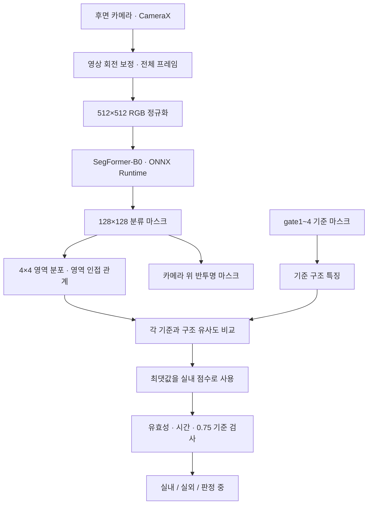
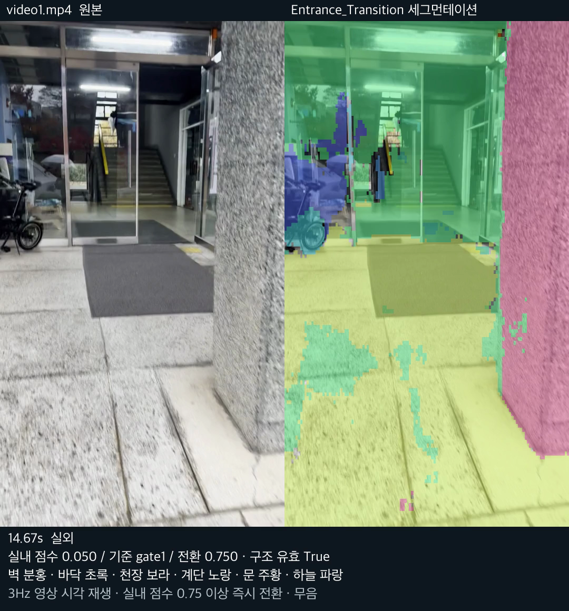
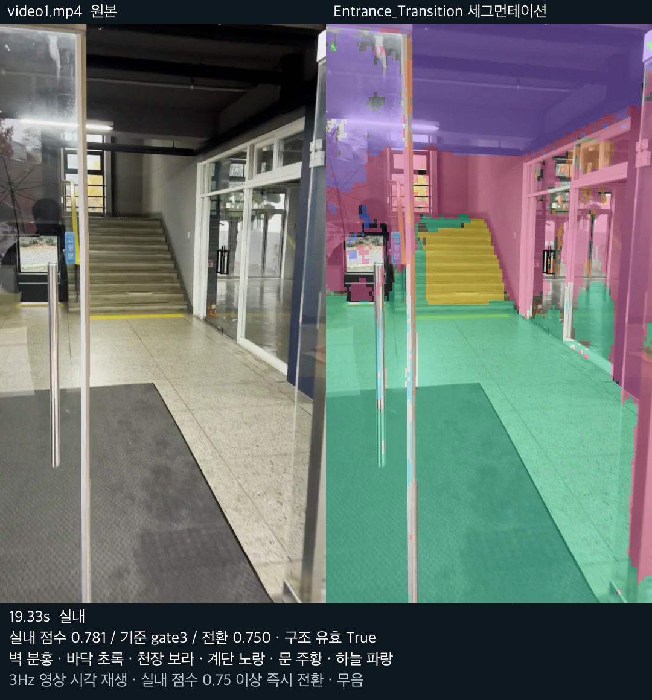
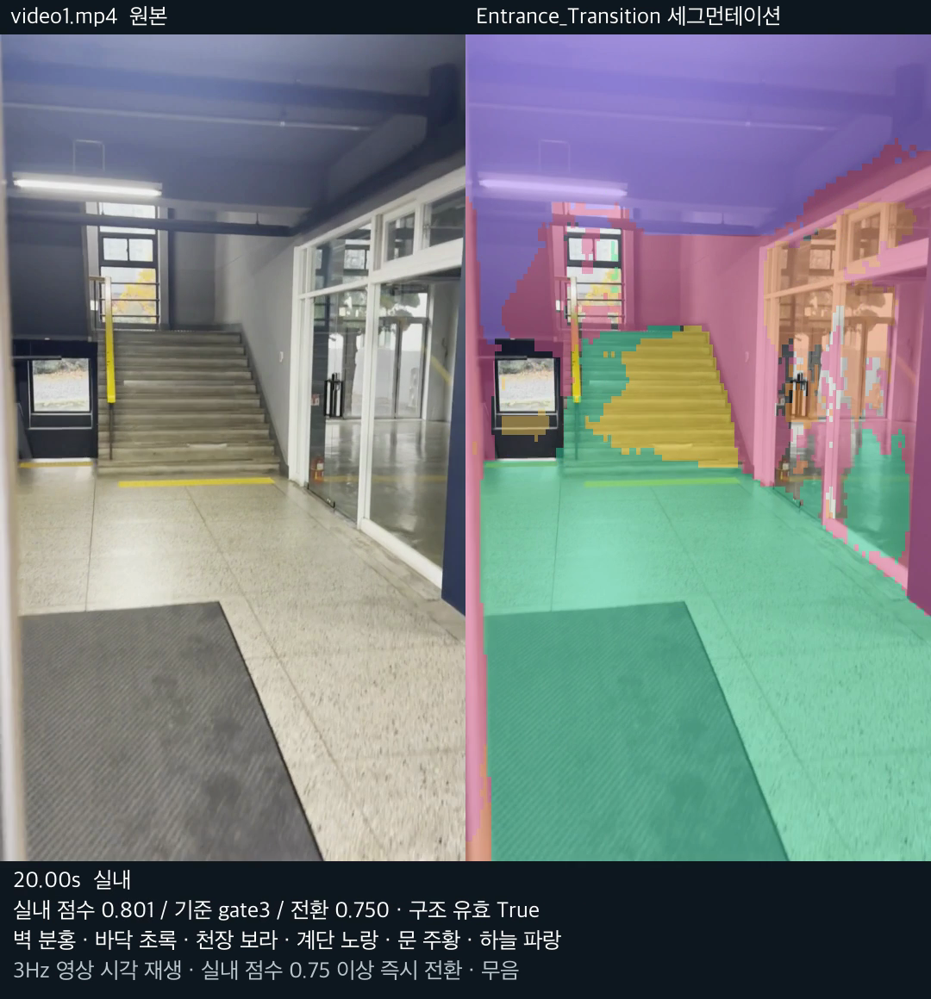
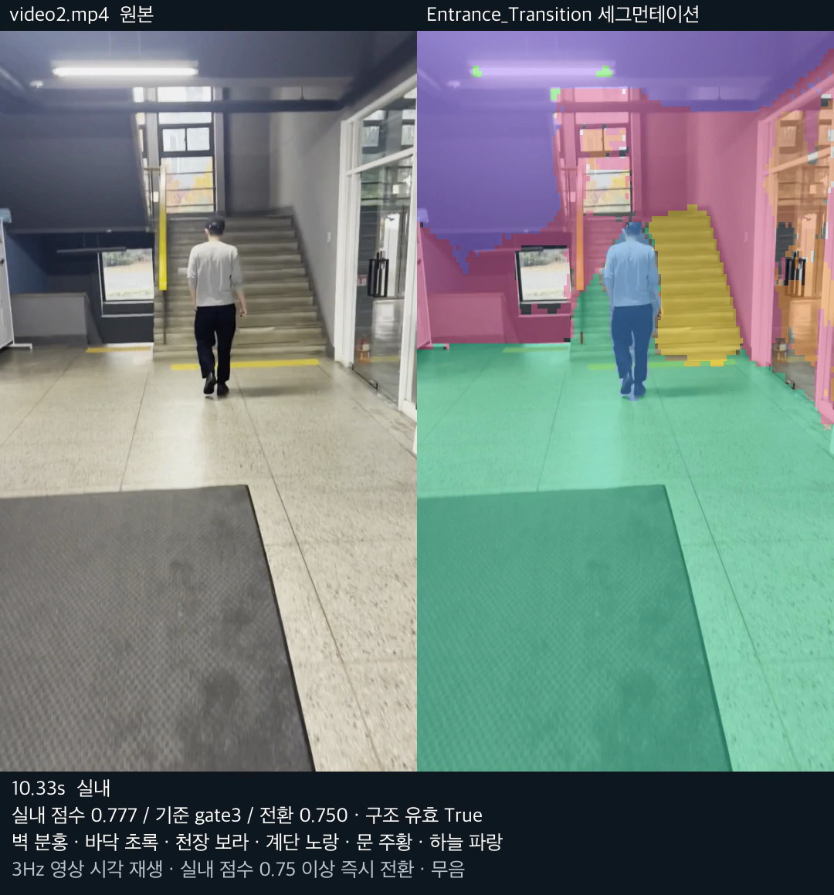

# 문화관 실내·실외 전환 모듈 설계 명세서

작성일: 2026-11-18 · 대상: `Entrance_Transition` · 기준: 현재 구현 및 gate1~4 영상 실험 결과

## 1. 목적과 범위

숭실대학교 **문화관**의 입구 주변을 촬영해 현재 화면이 등록된 실내 구조와 얼마나 비슷한지 계산하고, 화면에 **실내·실외·판정 중**을 표시한다. 카메라 영상 위에는 벽·바닥·천장·계단 등의 세그먼테이션 결과를 함께 표시한다.

[PRD](PRD.md)의 실내·외 경로 연계를 위한 선행 실험 모듈이다. 현재는 독립 Android 앱이며, 실외·실내 내비게이션 실행이나 위치·층 초기화는 연결되어 있지 않다. 사용자가 문화관을 촬영한다는 전제로 동작하며 GPS로 건물을 식별하지 않는다.

| 항목 | 명세 |
|---|---|
| 플랫폼 | Android, Java, 최소 API 24 / 대상 API 36 |
| 입력 | 후면 카메라 영상, 앱에 포함된 문화관 기준 마스크 |
| 출력 | 환경 상태, 실내 점수, 세그먼테이션 오버레이 |
| 모델 | OpenMMLab SegFormer-B0, ADE20K 150개 클래스 |
| 실행 | ONNX Runtime, 기기 내부 CPU 추론 |
| 분석 간격 | 최소 334ms 간격, 약 3회/초 이하. 실제 속도는 기기에 따라 달라짐 |
| 네트워크 | 앱 실행에 API 키·서버 연결 불필요 |

## 2. 전체 처리 구조



사진을 단순히 픽셀 색상으로 비교하지 않는다. 모델로 사진을 의미 영역으로 나눈 뒤 **영역의 배치와 연결 관계**를 비교한다. 계단 하나가 보인다는 이유만으로 실내로 전환하지 않는다.

### 구성 요소

| 클래스 | 책임 |
|---|---|
| `MainActivity` | 권한, 화면, 세션 시작·종료, 상태·점수 표시 |
| `TransitionCameraSession` | CameraX 연결, 프레임 간격 제한, 단일 작업 스레드 추론 |
| `SegformerSegmenter` / `SegformerLogits` | 전처리, ONNX 실행, 픽셀별 분류와 불확실 픽셀 제외 |
| `SegmentationMask` | 픽셀별 클래스 ID를 보관하는 마스크 |
| `StructureSignature` | 구조 특징 생성과 유사도 계산 |
| `MunhwaClassifier` | 문화관 기준 로딩·모델 검증·실내 최고 점수 계산 |
| `EnvironmentTransitionController` | 점수·유효성·시간으로 환경 상태 결정 |
| `SegmentationOverlay` | 프리뷰 좌표에 맞춰 분류 결과 표시 |

코드는 `app/src/main/java/com/example/entrancetransition/`와 `app/src/main/java/com/example/arnavigation/entrance/`에 있다. 두 패키지 모두 **전환 모듈 내부에 포함**되어 있어 다른 앱 폴더 없이 빌드할 수 있다.

## 3. 기준 데이터와 세그먼테이션

### 기준 데이터

실내 기준 사진은 [gate1](../assets/gate1.jpeg), [gate2](../assets/gate2.jpeg), [gate3](../assets/gate3.jpeg), [gate4](../assets/gate4.jpeg)다. 동일 모델과 전처리로 생성한 마스크를 `app/src/main/assets/munhwagwan.json`의 `insideMasks`에 저장한다. 앱은 시작할 때 마스크를 구조 특징으로 변환해 재사용한다.

`gate1~4`는 **등록 사진의 식별자**다. `matchedGate=gate3`는 gate3 사진과 구조가 가장 비슷했다는 의미이며, 실제 3번 출입구를 통과했다는 의미는 아니다. 현재 Android 앱은 최고 점수를 사용하고, 실험 도구는 gate별 점수와 최고 기준을 CSV에도 기록한다.

기준 파일에는 건물 ID `ssu-munhwagwan`, 모델 ID `mmseg-segformer-b0-ade20k-512-v1`, 모델 SHA-256, 전체 화면 정책 `upright-full-frame`이 포함된다. 시작 시 이를 검증하며 모델과 기준이 맞지 않으면 정상 판정을 시작하지 않는다. 기존 `outsideMasks` 데이터는 현재 점수 계산에 사용하지 않는다.

### 영상 처리

1. 카메라 영상의 회전을 바로잡고 전체 프레임을 512×512로 조정한다.
2. RGB 값을 0~1로 바꾸고 평균 `[0.485, 0.456, 0.406]`, 표준편차 `[0.229, 0.224, 0.225]`로 정규화한다.
3. 입력 텐서 `[1, 3, 512, 512]`를 모델에 전달해 150개 클래스의 logits를 얻는다.
4. logits를 목표 크기에 보간한 뒤 softmax와 argmax로 128×128 마스크를 만든다.
5. 최대 분류 확률이 **0.35 미만**인 픽셀은 `-1`로 표시해 구조 비교에서 제외한다.

**0.35는 픽셀의 분류 확실성 기준이고, 0.75는 최종 실내 전환 기준이다.** 서로 다른 단계에 적용한다.

오버레이는 벽 분홍, 바닥 초록, 천장 보라, 계단 노랑, 문 주황, 하늘 파랑 등으로 표시한다. 카메라의 회전·표시 영역 변환을 적용하며, `map_node`의 벽 좌표를 영상에 투영하는 기능은 아니다.

## 4. 실내 점수 계산

### 구조 유효성

마스크를 4×4, 총 16개 구역으로 나눈다. 비교 대상으로 정한 구조 클래스에 해당하는 픽셀이 구역 면적의 50% 이상인 구역이 **12개 이상**이고, 서로 다른 구조 클래스 사이의 인접 관계가 하나 이상 있어야 유효하다. 사람·차량 및 비교 대상 밖의 클래스는 구조 계산에서 제외한다.

전체 픽셀의 분류 확률이 높더라도 비교에 필요한 구조가 부족하면 `판정 중`이 될 수 있다.

### 유사도

각 구역에서 클래스별 비율을 구하고, 수평·수직으로 맞닿은 서로 다른 클래스 쌍의 빈도를 정규화한다. 현재 화면과 각 기준 사진을 다음과 같이 비교한다.

```text
구역 점수 = max(0, 1 - 16개 구역의 클래스 비율 L1 거리 합 / 32)
인접 점수 = max(0, 1 - 정규화한 클래스 쌍 빈도의 L1 거리 / 2)

gate별 유사도 = 0.6 × 구역 점수 + 0.4 × 인접 점수
실내 점수 = max(gate1 유사도, gate2 유사도, gate3 유사도, gate4 유사도)
```

L1 거리는 두 비율의 차이를 절댓값으로 더한 값이다. 점수는 0~1 범위의 **구조 유사도**이며, `0.75`를 실내일 확률 75%로 해석하지 않는다. 하늘·건물·지면 등 일부 실외 구조 클래스도 특징에 포함되지만 별도의 실외 점수는 계산하지 않는다.

## 5. 상태 전환 명세

| 조건 | 상태 | 표시 |
|---|---|---|
| 최신·유효 관측이고 실내 점수 ≥ 0.75 | `INDOOR` | 실내 |
| 최신·유효 관측이고 실내 점수 < 0.75 | `OUTDOOR` | 실외 |
| 구조 무효, 점수 NaN·무한대·범위 밖 | `UNKNOWN` | 판정 중 |
| 시작·세션 초기화, 마지막 관측 후 2초 초과 | `UNKNOWN` | 판정 중 |

유효한 한 프레임으로 즉시 바뀐다. 연속 프레임 수, 실외 점수, 실내·외 점수 차이, 사용자 확인 버튼은 사용하지 않는다. 실내 이후에도 점수가 0.75 미만이면 즉시 실외로 돌아간다.

`observe(inside, valid, capturedMs, nowMs)`가 관측을 받고, `tick(nowMs)`가 결과 만료를 확인하며, `reset()`이 세션 상태를 초기화한다. Android 시간은 `elapsedRealtime` 밀리초를 사용한다. 음수·미래·중복·역순·2초 넘게 지연된 관측은 무시한다. 무시된 관측으로 이전 상태를 덮어쓰지는 않지만, 이전 관측도 만료됐으면 `UNKNOWN`이 된다.

카메라는 최신 프레임만 유지하고 한 작업 스레드에서 모델을 실행한다. 세션 종료 시 카메라 분석을 해제하고 모델을 순서대로 닫는다. 종료된 세션의 콜백은 화면에 반영하지 않는다. 권한 거부·카메라·모델·추론 오류는 화면에 안내하고 판정을 복구할 수 있게 한다.

## 6. 결과 영상 검증

### 실험 조건

사용한 결과는 **gate1~4와 임계값 0.75를 적용한** `assets/transition_results_075_gate1to4`다. PC에서 영상을 3Hz로 샘플링하고 ONNX 모델 및 앱의 Java 구조 비교·상태 판정 코드를 적용한 결과다. Android 앱 화면 녹화나 기기 처리 속도 측정은 아니다. 아래 시각은 실험의 영상 샘플 시각이며, 실제 문 통과 정답 시각은 별도로 주석 처리하지 않았다.

왼쪽은 원본 화면, 오른쪽은 분류 마스크를 겹친 화면이다. 아래 이미지는 **기존 결과 MP4에서 해당 프레임을 그대로 추출**했으며, 하단에 상태·점수·최고 기준이 표시된다.

| 항목 | video1 | video2 |
|---|---:|---:|
| 원본 길이 | 21.37초 | 12.10초 |
| 분석한 프레임 | 64개 | 36개 |
| 구조 유효 프레임 | 53개 | 32개 |
| 실내로 판정한 프레임 | 5개 | 5개 |
| 최초 실내 시각 | 19.333초 | 10.333초 |
| 최초 실내 최고 기준 | gate3 | gate3 |

이 수치는 판정 기록이며 정확도나 성공률을 의미하지 않는다. 결과의 모델·기준 파일 SHA-256이 현재 앱의 파일과 일치함을 확인했다.

### video1: 실외 판정 — 14.667초

실내 점수는 **0.049915(약 0.05)**, 최고 기준은 **gate1**이다. 구조는 유효하지만 실내 점수가 0.75 미만이므로 **실외**로 판정했다.



### video1: 최초 실내 전환 — 19.333초

직전 19.000초에는 실내 점수 **0.689185**로 실외였다. 다음 관측에서 **0.780596**으로 임계값을 넘어 실내로 바뀌었다. gate4도 0.75를 넘었지만, 더 높은 gate3가 최고 기준으로 기록됐다.



| 시각 | gate1 | gate2 | gate3 | gate4 | 판정 |
|---|---:|---:|---:|---:|---|
| 19.000초 | 0.547063 | 0.632070 | **0.689185** | 0.686380 | 실외 |
| 19.333초 | 0.618332 | 0.716372 | **0.780596** | 0.764923 | 실내 |
| 19.667초 | 0.536017 | 0.690359 | **0.747062** | 0.686565 | 실외 |
| 20.000초 | 0.576274 | 0.735970 | **0.801085** | 0.760735 | 실내 |

### video1: 재전환 — 20.000초

19.667초에는 점수가 **0.747062**로 내려가 실외로 돌아갔다. 20.000초에는 **0.801085**로 다시 실내가 됐고, 마지막 관측인 21.000초까지 실내를 유지했다. 이는 임계값 주변에서 상태가 흔들릴 수 있는 현재 설계의 특성을 보여준다.



### video2: 최초 실내 전환 — 10.333초

직전 10.000초에는 **0.682924**로 실외였다. 10.333초에 **0.776731**로 실내가 됐고, 마지막 관측인 11.667초까지 실내를 유지했다. 이 프레임에서 임계값을 넘은 기준은 gate3다.



| 시각 | gate1 | gate2 | gate3 | gate4 | 판정 |
|---|---:|---:|---:|---:|---|
| 10.000초 | 0.629423 | 0.650960 | **0.682924** | 0.645538 | 실외 |
| 10.333초 | 0.612764 | 0.728798 | **0.776731** | 0.691096 | 실내 |

### 결과 원본과 추적 정보

| 영상 | 결과 MP4 | 프레임별 점수 | 요약 |
|---|---|---|---|
| video1 | [영상](../assets/transition_results_075_gate1to4/video1/video1_transition.mp4) | [CSV](../assets/transition_results_075_gate1to4/video1/observations.csv) | [JSON](../assets/transition_results_075_gate1to4/video1/summary.json) |
| video2 | [영상](../assets/transition_results_075_gate1to4/video2/video2_transition.mp4) | [CSV](../assets/transition_results_075_gate1to4/video2/observations.csv) | [JSON](../assets/transition_results_075_gate1to4/video2/summary.json) |

[추출 프레임 기록](images/entrance-transition/frames.json)에 결과 영상 경로·SHA-256·0부터 시작하는 프레임 번호·CSV 관측값을 저장했다. 삽입한 프레임 번호는 video1의 44·58·60, video2의 31이다. 결과 영상은 3fps이므로 각 번호를 3으로 나눈 시각에 대응한다. 영상 하단 점수는 소수 셋째 자리로 표시되고 위 표는 CSV 값을 여섯째 자리로 반올림했다.

## 7. 검증 기준과 한계

### 현재 코드 검증

모듈만 분리한 환경에서 APK 빌드, 단위 테스트 6개, Lint가 통과했다. 단위 테스트는 0.75 포함 경계, 즉시 전환·복귀, 무효 점수·구조, 지연·중복·역순 프레임, 세션 초기화와 결과 만료, 등록 기준 마스크의 유효성을 확인한다.

```bash
cd Entrance_Transition
./gradlew :app:testDebugUnitTest :app:assembleDebug :app:lintDebug
```

### 적용 시 주의할 점

- 문 밖에서 실내 구조가 보이는 경우에도 실내로 판정할 수 있다. 이번 video1 최초 전환 프레임도 입구를 바라보는 장면이므로, 실내 판정을 실제 문 통과의 증거로 사용할 수 없다.
- 다른 건물의 구조가 비슷해도 높은 점수가 나올 수 있다. 현재 점수만으로 문화관임을 인증하지 않는다.
- 카메라 방향·가림·조명에 따라 점수가 바뀌며, 0.75 주변에서는 video1처럼 실내·외가 반복될 수 있다.
- 두 영상의 관측 결과만으로 현장 정확도를 결론 내릴 수 없다. 실제 진입 시각을 표시한 별도 영상과 다양한 기기·촬영 조건으로 오탐·누락·전환 지연을 평가해야 한다.

향후 내비게이션과 연결할 때는 건물·출입구 식별, 실내 시작 노드·층·방향 설정, 상태 반복 시 처리 규칙을 별도로 설계해야 한다. 현재 모듈은 환경 판정과 화면 표시까지만 담당한다.
