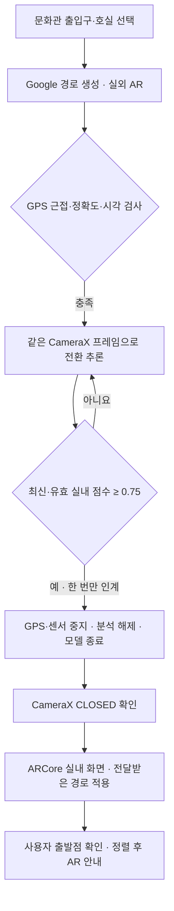

# 통합 AR 내비게이션 실행 가이드

작성일: 2026-11-19 · 프로젝트: [AR_Navigation_Final](../AR_Navigation_Final/)

## 실행할 프로젝트

Android Studio에서 **`AR_Navigation_Final` 폴더**를 열고 `app` 실행 구성을 선택합니다. 실내 코드는 같은 프로젝트의 `indoor` 라이브러리에 포함되어 하나의 APK로 설치됩니다. 기존 `outdoor_navi`, `Entrance_Transition`, `indoor_navi`는 유지했습니다.

- [프로젝트 README](../AR_Navigation_Final/README.md)
- [디버그 APK](../AR_Navigation_Final/app/build/outputs/apk/debug/app-debug.apk)
- 디버그 패키지: `com.example.arnavigation.finalapp.debug`

## 사용 순서

1. 위치·카메라 권한을 허용합니다.
2. 홈 지도에서 문화관 1층 출입구 위치를 누릅니다. 장소 검색으로 선택했다면 좌표가 건물 중심이 아닌 실제 출입구인지 확인합니다.
3. **문화관 출입구·호실 연결**을 누르고 선택 좌표를 확인합니다.
4. 문화관 실내 지도 화면에서 호실을 검색·선택하고 `경로 찾기`를 누릅니다. 시작 노드는 `F1_ENTRY_MAIN`으로 고정됩니다.
5. `이 호실까지 실외 안내 시작`을 누르면 Google 보행 경로를 생성하고 실외 AR 안내로 이동합니다.
6. 출입구 근처에서는 전환 판정이 함께 실행됩니다. 최신·유효 실내 점수가 0.75 이상이면 두 모듈을 정리한 뒤 실내 화면을 엽니다.
7. 실내에서 실제 출발 위치·방향·바닥 정렬을 확인하고 안내를 시작합니다. 선택한 호실과 계산한 실내 경로를 다시 선택할 필요는 없습니다.

문화관 버튼은 다른 건물용 자동 식별 기능이 아닙니다. 현재는 사용자가 문화관 출입구를 지정하는 파일럿 흐름입니다. 실제 출입구 GPS 좌표의 사전 검증은 남아 있습니다.

## 통합 동작



| 항목 | 통합본 설정 |
|---|---|
| 근접 기준 | 선택 출입구에서 30m 이내 |
| GPS 신뢰 조건 | 관측 5초 이내, 수평 정확도 20m 이하 |
| 전환 분석 | 약 3Hz 이하, 실외 프리뷰와 카메라 공유 |
| 실내 기준 | gate1~4 구조 유사도의 최댓값 ≥ 0.75 |
| 관측 만료 | 2초 초과 관측으로 인계하지 않음 |
| 카메라 인계 | 분석 해제·모델 종료 후 하드웨어 CLOSED 확인, 최대 5초 |
| 실내 시작점 | 문화관 1층 도면 하단 출입구 `F1_ENTRY_MAIN` |
| 중복 방지 | 세션 목적지 ID 대조 + 인계 상태 고정 |

GPS 값은 `JourneyGate`의 초기 파일럿 설정입니다. GPS 근접은 전환 추론을 시작하는 조건이며 실내 점수와 합산하지 않습니다. 근접 후 GPS가 흔들려도 추론을 반복 생성하지 않습니다. 인계 후에는 전환 모델을 종료하므로 실외 점수에 따른 자동 역방향 전환은 없습니다.

## API·빌드 환경

전체 JDK 21, Android SDK 36.1 및 포함된 Gradle Wrapper를 사용합니다. 소스 언어는 Java 17이며 최소 API 24, 대상 API 36입니다.

기존 컴퓨터의 API·SDK 로컬 설정은 새 폴더의 `local.properties`에 복사했으며 Git에서 제외했습니다. 새 컴퓨터에서는 환경변수 또는 `local.properties`로 Maps·Places·Routes 키/프록시를 설정합니다. 실제 Google API 요청 성공 여부를 로컬 키의 존재만으로 보장할 수는 없습니다.

**키에 Android 앱 제한이 있으면 Google Cloud에 새 디버그 패키지와 서명 SHA-1을 등록해야 합니다.** 서명 확인 명령은 `./gradlew :app:signingReport`입니다. 기존 앱용 패키지만 등록된 키는 새 통합 앱에서 거부될 수 있습니다.

```bash
cd AR_Navigation_Final
./gradlew :app:assembleDebug :app:testDebugUnitTest :indoor:testDebugUnitTest :app:lintDebug
./gradlew :app:connectedDebugAndroidTest -Pandroid.testInstrumentationRunnerArguments.class=com.example.arnavigation.journey.FinalPipelineIntegrationTest
```

## 검증 범위

- 단위 테스트: 앱 98개, 실내 라이브러리 135개, 총 233개 통과. GPS 거리·정확도·만료, 0.75 경계, 무효·오래된 프레임, 중복 인계 방지와 기존 경로·정렬 로직을 포함합니다.
- 통합 APK 빌드·Lint 통과. 에뮬레이터 통합 테스트 1개 통과: 번들 문화관 지도 로딩, 출발 노드 고정, 목적 호실 경로 계산, 지도·층별 좌표·의미 지도 데이터 반환을 확인했습니다.
- 에뮬레이터에서 홈 지도·문화관 연결 버튼이 정상 표시되는 것을 확인했습니다.
- Google 경로 요청 성공, 실제 문화관 진입 후 카메라 인계, ARCore 정렬·층간 이동 정확도는 현장 실기기 검증이 필요합니다.

실내 판정은 실제 문 통과나 절대 위치·층의 확정이 아닙니다. 이 통합본은 자동 모듈 인계 흐름을 연결한 디버그 빌드이며, 서명된 운영 배포본과 현장 검증은 별도입니다.
